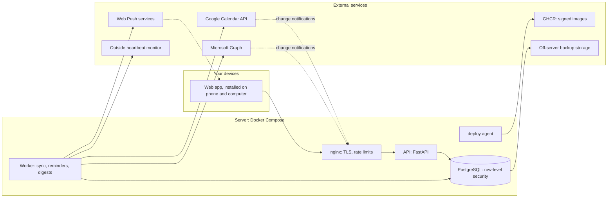

# work-hub plan

work-hub is a self-hosted web app for your work and your personal projects: tasks,
meetings, notes and calendars, kept in separate workspaces. It is built from modules.
Each module is a GitHub milestone with its own plan file in [docs/plan/](plan/), its own
ADRs, tests and measured results, so modules can be built one at a time or in parallel.
Known constraints and how the plan handles them are in [RISKS.md](RISKS.md).

## Ground rules

- **Hosting**: the app and its data run on one small Linux server with Docker Compose,
  shared with other small services. Outside it there are only the image registry,
  encrypted backups and a heartbeat monitor.
- **Exposure**: the app is on the public internet under its own hostname, so sign-in is
  the perimeter. nginx is the only listener on the public interface; the API, the worker
  and the database bind to loopback or to a private Docker network.
- **Accounts**: no self-registration. The owner creates each account from the server's
  command line and hands over a one-time enrollment link. Sign-in is by passkey only;
  there is no password to guess, reuse or phish.
- **Workspaces are walls**: every row belongs to a workspace, PostgreSQL row-level
  security enforces it below the application code, and focus mode narrows a session to
  one workspace in the database itself.
- **Other people's data**: connected accounts get read-only scopes; their tokens are
  encrypted with a key kept outside the database and its backups; every connection can
  be revoked in one step. Nothing from a workspace leaves the server in readable form
  (notifications and backups are encrypted) unless a module that does so is switched on
  for that workspace.
- **Web first, sync-ready**: the web app is the first client and installs on a phone and
  a computer. IDs, versions and tombstones follow sync-ready conventions from the first
  migration, so a desktop app with offline sync can follow without a rewrite.
- **Pull-based delivery**: CI runs on GitHub-hosted runners and signs every image; the
  server pulls and verifies. No runner on the server, no inbound path from CI.
- **Pull requests only**: every change goes through a pull request with all checks green.
- **Decisions in writing**: every significant decision gets an ADR in `docs/adr/`.
- **Evidence**: no number goes in the README unless a test or a script produced it.
- **Demo data only**: fixtures, screenshots, issues and recordings use one made-up
  company and made-up people. Real notes and calendars never enter the repository.

## Architecture



The worker joins the stack with M06; Phase 1 runs the API and the database only.

## Components

| Component | Technology | Modules |
|---|---|---|
| Web app | React, TypeScript, Vite; installable (service worker, Web Push) | M01 to M08 |
| API | Python, FastAPI, SQLAlchemy, Alembic; OpenAPI is the contract | M01 to M08 |
| Admin CLI (`hubctl`) | Python, inside the API image; runs only on the server | M02, M03 |
| Database | PostgreSQL: row-level security, full-text search | all |
| Worker | The API image with another command; a queue in PostgreSQL | M06, M07 |
| Reverse proxy | nginx on the host, Let's Encrypt certificates | P1 |
| Server baseline | Ansible | P1 |
| Backups | Database dumps, encrypted before they leave the server | P1 |
| Deploy agent | A systemd timer, cosign verification, Docker Compose | P2 |
| Calendar connectors | Google Calendar API, Microsoft Graph, ICS subscriptions | M06 |

## Data walls

| Wall | Enforced by |
|---|---|
| Between accounts | Row-level security on membership; no endpoint lists other accounts |
| Between the workspaces of one account | Row-level security on the workspaces in view; focus mode narrows it to one |
| Between the hub and other services on the server | Its own Compose project, network, volumes and system user; loopback-only ports |
| Between the database and connected-account tokens | Encryption with a key outside the database and its backups |
| Between CI and the server | Pull-based delivery; no credential for the server exists in CI |
| Between the repository and real data | Demo data only; a CI guard on email addresses |

## Code layout

```
api/          FastAPI app: routers, services, models, migrations, the hubctl admin CLI
web/          React and TypeScript web app
infra/        compose files, nginx, ansible, deploy agent, backup scripts
tests/        end-to-end tests (Playwright), load tests (k6), fixtures with demo data
docs/         plan, adr, threat-model, runbooks, results
scripts/      plan sync and repository checks
```

The repository has one version line: the API, the worker and the web app ship together.

## Modules

| ID | Module | Track | Size | Depends on | Plan |
|---|---|---|---|---|---|
| P0 | Foundation | A | M | - | [P0](plan/P0-foundation.md) |
| P1 | Server runtime | A | L | P0 | [P1](plan/P1-server-runtime.md) |
| P2 | Secure delivery | A | L | P1, M01 | [P2](plan/P2-secure-delivery.md) |
| M01 | App skeleton | B | M | P0 | [M01](plan/M01-app-skeleton.md) |
| M02 | Accounts and sign-in | B | L | M01 | [M02](plan/M02-accounts-sign-in.md) |
| M03 | Workspaces | B | L | M02 | [M03](plan/M03-workspaces.md) |
| M04 | Tasks | B | M | M03 | [M04](plan/M04-tasks.md) |
| M05 | Notes and search | B | M | M04 | [M05](plan/M05-notes-search.md) |
| M06 | Calendars | C | XL | M03, P1 | [M06](plan/M06-calendars.md) |
| M07 | Reminders | C | L | M04, M06 | [M07](plan/M07-reminders.md) |
| M08 | Meetings | C | M | M05, M06 | [M08](plan/M08-meetings.md) |

Sizes are relative effort: S, M, L, XL.

## Tracks (for parallel work)

- **A Platform**: P0, P1, P2
- **B Core**: M01, M02, M03, M04, M05
- **C Schedule**: M06, M07, M08

## Phases and releases

| Phase | Milestones | Release |
|---|---|---|
| 1 | P0, then M01 to M05 with P1 and P2 in parallel | v0.1.0: tasks and notes in workspaces, on the server, in daily use |
| 2 | M06, M07, M08 | v0.2.0: every calendar in one agenda, reminders, notes per meeting |
| Later | See [Later modules](#later-modules) | v0.3.0 onward, then v1.0.0 |

- A first usable build (M01 to M04) runs on a developer machine with `task up` before the
  server work is finished.
- Until P2 lands, no image of ours runs on the server: nothing is deployed before signing
  and verification exist.
- The spike M06-01 (which accounts can connect) runs during Phase 1, so Phase 2 is not
  planned blind.
- Phase 1 is complete on its own: later phases can slip without breaking it.

## Later modules

These are planned in order of likely value. Each gets its plan file and its issues when
the phase before it ships.

| Module | What it adds | Builds on | Note |
|---|---|---|---|
| People | People per workspace, 1:1 history, what each side owes the other | M08 | Notes about people are the most sensitive data in the app |
| Reviews and reports | A weekly summary per workspace ready to paste; time per workspace | M04, M08 | Built from task history and meeting decisions |
| Task sources | Read-only import of items assigned to you in other trackers, for example GitHub, Jira or Azure DevOps | M04, the token vault of M06 | Same data rules as calendars |
| iPhone support | Home-screen install and notifications tested and fixed on iOS | M07 | iOS delivers Web Push only to an installed app |
| Desktop app and offline sync | A desktop shell around the web app (tray, global quick add) with a local store that syncs | The conventions of M01 | Conflict rules are decided here |
| Transcripts | Transcripts made on your own machine, attached to meeting notes | M08 | Only for meetings where every attendee agreed |
| Automatic meeting notes | Record in the desktop app, transcribe locally, draft the notes | Desktop app, Transcripts | Consent recorded per meeting; off by default |
| Agent access | A scoped interface for AI assistants: read today's items, add tasks and action items | M04, M08 | Per workspace, off by default; event and note text is untrusted input |
| Calendar write-back | Copy "busy" blocks from one of your calendars to another | M06 | Needs write scopes and a separate consent |
| Shared workspaces | Other accounts join a workspace with a role | M03 | Accounts stay owner-provisioned |
| v1.0.0 release | Documentation, upgrade path, published results | all | |

## Decisions

ADR numbers are assigned when each record is written.

| Decision | Status | Milestone |
|---|---|---|
| Record architecture decisions | proposed | P0 |
| Public service with owner-provisioned accounts, instead of a private network | decided | P0 |
| Web app first; a desktop app later on the same API | decided | P0 |
| Stack: FastAPI, PostgreSQL, React and TypeScript | decided | P0 |
| Merge commits with signed commits (rebase merges drop signature verification) | decided | P0 |
| Pull-based signed delivery | decided | P0 |
| Dependabot for dependency updates (first-party, no extra app with write access) | decided | P0 |
| Sharing the host with other services | proposed | P1 |
| Admin access to the server | proposed | P1 |
| Backup target and encryption | proposed | P1 |
| Build once on `main`, promote digests to releases | proposed | P2 |
| Deploy agent and its access to Docker | proposed | P2 |
| Database migrations: expand and contract | proposed | P2 |
| Web app and API architecture: one origin, OpenAPI contract | proposed | M01 |
| Sync-ready data conventions | proposed | M01 |
| Sign-in with passkeys only | proposed | M02 |
| Workspace isolation with row-level security | proposed | M03 |
| Calendar access model: read-only, polling with incremental sync | proposed | M06 |
| Background jobs on PostgreSQL, no message broker | proposed | M06 |
| Reminders by Web Push | proposed | M07 |
| Meeting identity across calendar changes | proposed | M08 |

## Prerequisites

Before Phase 1:
- An SSH key for signing commits, registered on GitHub.
- A Linux server with Docker and a DNS name for the hub. Privileged steps on the server
  are run by the owner.
- An Android phone with Chrome and a computer with a platform authenticator, for the
  passkey tests.
- An account at an outside heartbeat monitor, and off-server storage for encrypted
  backups.

Before Phase 2:
- A Google Cloud project and a Microsoft Entra app registration for the calendar
  connections, created by the owner.
- The result of the spike M06-01, and your organization's answer where a work account
  is involved.

## Working agreements

- Branches `<type>/<issue>-<short-name>`; Conventional Commits; one concern per commit;
  merge commits, so the signed per-concern commits survive on `main`.
- Definition of done: tests pass, docs updated, ADR written if a decision was made,
  threat model and RISKS.md updated if a trust boundary or a risk changed, results
  updated if a number changed.
- Every endpoint ships with its isolation tests in both directions (M03-04); a module is
  not done while one is missing.
- Labels: `type:*` (feature, bug, chore, ci, docs, security, test, adr, spike) and
  `area:*` (one per milestone).
- Public project board: the sync script adds every issue; the built-in Status and
  Milestone fields carry the state and the module, and saved views filter by track and
  phase.
- Issues in each plan file use the form `- <ID> [type] Title -- Done when: ...`. The ID
  never changes; the sync script uses it to create or update the issue.
- Fast gates block the merge; slow gates (DAST, load tests) run nightly and block the
  promotion to a release.
- Parallel work: each module owns its directories; shared files (the base compose file,
  shared workflows, the OpenAPI contract, this plan) change only in their own pull
  requests; one git worktree per track.

## Measured results to publish

Every result records the hardware, the software versions, the number of runs and the
median. Load tests on seeded demo data state the size of the data set.

- Tests per component and coverage; the number of endpoints covered by isolation tests.
- Sign-in time with a passkey (M02).
- Today view and search p95 on seeded data; the overhead of row-level security (M03 to
  M05).
- Restore time from the latest backup; time from a stopped component to the outside
  alert (P1).
- Merge-to-running time and rollback time (P2).
- Sync lag from a change at the provider to the agenda, with polling only and with
  change notifications (M06).
- Reminder delay and delivery success over a week of daily use on Android (M07).
- OpenSSF Scorecard score; critical and high CVEs in released images (target 0);
  medium or higher DAST findings (target 0).
- Lighthouse performance and accessibility scores of the web app.
